# CustomerTicketingTool - Environment Setup Guide

This guide covers setting up everything needed to build, run and customize the CustomerTicketingTool Microsoft Teams tab app, including the Azure OpenAI chatbox.

Contents:

1. [Install Visual Studio Code](#1-install-visual-studio-code)
2. [Create the tab app](#2-create-the-tab-app)
3. [Install the Microsoft 365 Agents Toolkit](#3-install-the-microsoft-365-agents-toolkit)
4. [Configure Azure OpenAI](#4-configure-azure-openai)
5. [Run and debug the app](#5-run-and-debug-the-app)
6. [Customize the UI from code](#6-customize-the-ui-from-code)
7. [Zip the app package and upload it to Teams](#7-zip-the-app-package-and-upload-it-to-teams)
8. [Troubleshooting](#8-troubleshooting)

---

## 1. Install Visual Studio Code

1. Download VS Code from <https://code.visualstudio.com/> and run the installer.
2. Install [Node.js](https://nodejs.org/) version **22 or later** (required by this template). Verify in a terminal:

   ```powershell
   node --version
   npm --version
   ```

3. (Optional) Install [Git](https://git-scm.com/).
4. Open VS Code.

---

## 2. Create the tab app

This section is adapted from the Microsoft Learn exercise
[Build a Microsoft Teams tab app](https://learn.microsoft.com/en-us/training/modules/teams-toolkit-vsc-tab-app/build-tab-app-exercise).
Differences from that exercise: the toolkit is now called the Microsoft 365 Agents Toolkit, the template is TypeScript/React based (`src/Tab/App.tsx`), and the UI is changed in React code instead of `hello.html`.

### Clone the git repository (recommended)

1. Open a terminal in the folder where you keep your projects (for example, `Documents`).
2. Clone the repository:

   ```powershell
   git clone https://github.com/ng-jianshn/teams-app.git
   ```

3. In VS Code, select **File > Open Folder** and open the cloned `teams-app` folder.

> **Important:** Open the folder that directly contains `m365agents.yml`, `package.json` and `appPackage/`. This must be the root of the workspace, not a nested folder (for example, `Documents\teams-app\teams-app`). Otherwise the Microsoft 365 Agents Toolkit cannot recognise the project later on.

### Create a new project from the template (alternative)

<details>
<summary>Show steps</summary>

> **Note:** If you do not want to clone the repository, you can create the project directly in VS Code using the steps below. However, the repository contains modifications that add LLM calling (Azure OpenAI), and those features are not present in the default sample template.

1. In VS Code, select the **Microsoft 365 Agents Toolkit** icon in the Activity Bar.
2. Select **Create a New Agent/App**.

   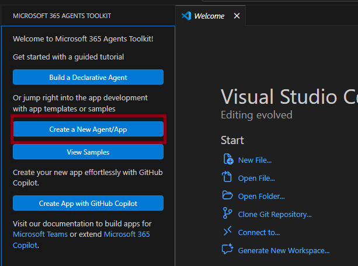

3. Choose **Teams Agents and Apps**.

   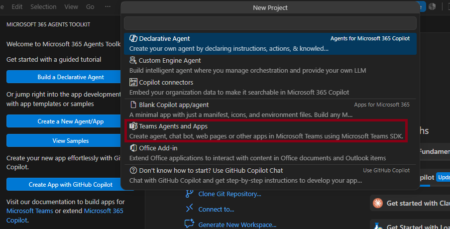
4. Select **Other Teams Capabilities**.
5. Select **Tab**.
6. Select the workspace folder (for example, `Documents\TeamsApp`).
7. Enter the application name: **CustomerTicketingTool**.
8. A notification confirms the project was scaffolded, and VS Code opens the new project.

   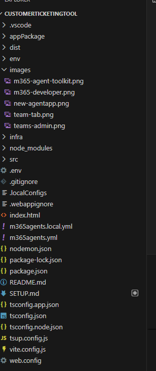

</details>

### Project structure

| Path | Purpose |
| --- | --- |
| `src/index.ts` | Node/Express backend. Serves the tab and the `/api/chat` endpoint |
| `src/Tab/App.tsx` | React UI of the tab (the page users see) |
| `src/Tab/App.css` | Styles for the tab |
| `src/Tab/client.tsx` | React entry point |
| `index.html` | HTML shell for the tab |
| `appPackage/manifest.json` | Teams app manifest (name, icons, tab definition) |
| `m365agents.yml` / `m365agents.local.yml` | Toolkit lifecycle files for remote and local environments |
| `env/` | Environment files for the toolkit (`.env.dev`, etc.) |
| `infra/` | Bicep templates for Azure deployment |
| `.vscode/` | Debug and task configuration |
| `.env` | Local secrets (Azure OpenAI settings). Git-ignored |

---

## 3. Install the Microsoft 365 Agents Toolkit

The Microsoft 365 Agents Toolkit (formerly Teams Toolkit) is a VS Code extension that scaffolds, provisions and debugs Teams apps.

1. In VS Code, open the **Extensions** view (`Ctrl+Shift+X`).
2. Search for **Microsoft 365 Agents Toolkit** (publisher: Microsoft) and select **Install**.
3. After installation, the toolkit icon appears in the Activity Bar on the left.

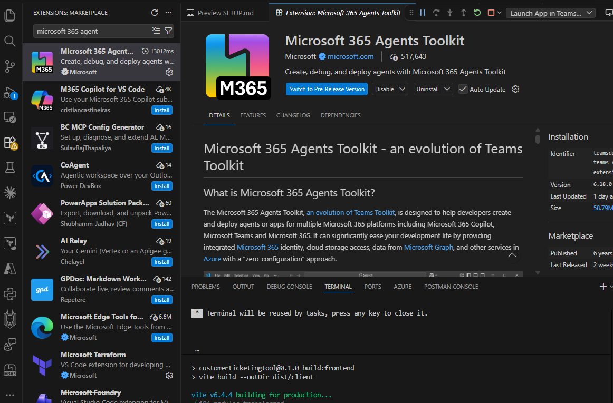

4. Select the toolkit icon to open the toolkit panel.
5. In the **ACCOUNTS** section, select **Sign in to Microsoft 365** and sign in with your Microsoft 365 developer account.

> The toolkit requires a work or school account with custom app upload permission. Personal Microsoft accounts are not supported.

6. Set up two-factor authentication (2FA) for your account with an authenticator app of your choice (for example, Microsoft Authenticator or Google Authenticator). Follow the on-screen prompts to scan the QR code and verify the code when signing in.

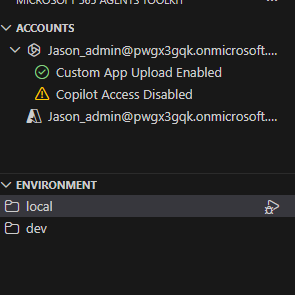

> **Reminder:** Always sign in with the Microsoft 365 developer sandbox account, not your personal or work account.

---

## 4. Configure Azure OpenAI

The chatbox in the tab sends messages to the backend (`POST /api/chat`), which calls Azure OpenAI. The API key stays on the server and is never sent to the browser.

### Prerequisites in Azure

1. In the [Azure portal](https://portal.azure.com) or Microsoft Foundry, create an **Azure OpenAI / Foundry** resource.
2. Deploy a chat model and note the **deployment name** (this is not necessarily the model name).
3. Copy the **endpoint** and an **API key** from the resource's **Keys and Endpoint** page.

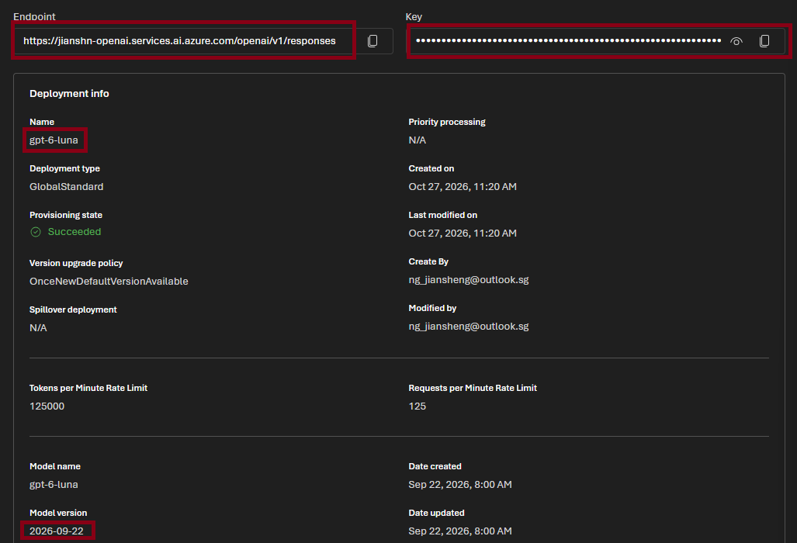

### Create the `.env` file

In the project root, copy the contents of `.env.temp` and paste them into a new file named `.env`, then fill in your own values:

```dotenv
AZURE_OPENAI_ENDPOINT=https://<your-resource>.services.ai.azure.com
AZURE_OPENAI_API_KEY=<your-api-key>
AZURE_OPENAI_DEPLOYMENT=<your-deployment-name>
# Optional
AZURE_OPENAI_SYSTEM_PROMPT=You are a helpful assistant for a customer ticketing tool.
```

Notes:

- `.env` is listed in `.gitignore`. Never commit it or share the key.
- The endpoint can be either `https://<resource>.openai.azure.com` or `https://<resource>.services.ai.azure.com`. Only the host is used.
- The backend calls `<endpoint>/openai/v1/chat/completions` with the deployment name as the `model`.
- The `.env` file is read **once when the Node process starts**. After editing it, stop and restart the app.

---

## 5. Run and debug the app

### Start debugging

Press `F5`, or select **Run** > **Start Debugging**.

The toolkit then:

1. Validates prerequisites (Node.js, Microsoft 365 account, ports `3978` and `9239`).
2. Provisions the Teams app registration for the `local` environment.
3. Deploys (installs dependencies, creates the local HTTPS dev certificate and `.localConfigs`).
4. Starts the app (`npm run dev:teamsfx`), which builds the frontend, then runs the backend with nodemon.

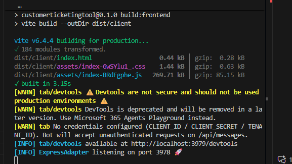

### Install the app in Teams

1. A browser window opens Teams. In the **CustomerTicketingTool** dialog, select **Add**.

   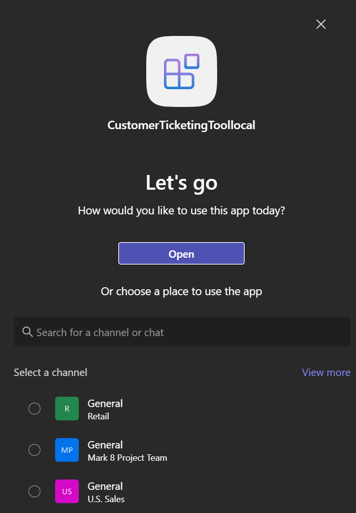

2. The app opens as a personal tab, with the chatbox visible.

   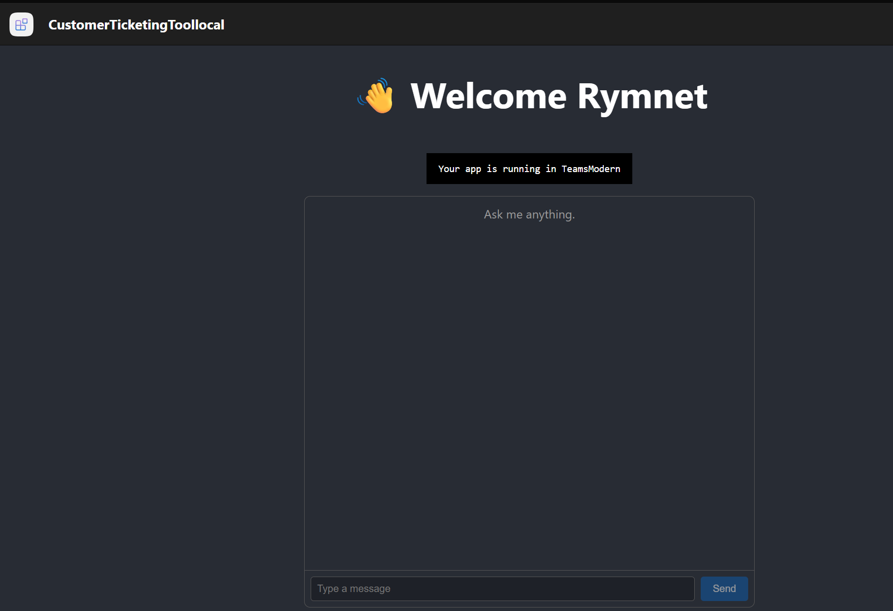

### Restarting

- To re-run, stop the **Start application** terminal first (the ports must be free), then run the task again.
- Changes to files in `src/` restart the backend automatically via nodemon.
- Changes to `.env` require a manual restart.

---

## 6. Customize the UI from code

The tab UI is a React app. There is no `hello.html` as in the Learn exercise; edit these files instead.

### Change the text

Open [src/Tab/App.tsx](src/Tab/App.tsx) and go to line 59, which contains the heading:

```tsx
<h1>👋 Welcome Rymnet</h1>
```

Change it, for example:

```tsx
<h1>Customer Ticketing Tool</h1>
```

Save the file. nodemon rebuilds and restarts the app; refresh the tab in the browser to see the change.

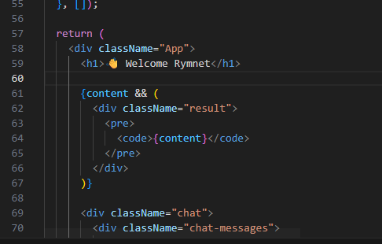

### Change the styling

Open [src/Tab/App.css](src/Tab/App.css). Useful selectors:

| Selector | Controls |
| --- | --- |
| `.App` | Page background, text color and layout |
| `h1` | Heading size |
| `.chat` | Chat container (width, border) |
| `.chat-msg.user` / `.chat-msg.assistant` | Message bubble colors |
| `.chat-input` | Input row and Send button |

Example: change user bubble color:

```css
.chat-msg.user {
  align-self: flex-end;
  background-color: #6264a7; /* Teams purple */
}
```

### Change the chatbox behavior

- **UI and request logic**: `App.tsx` (`messages` state, the `send()` function that calls `fetch("/api/chat")`, and the `.chat` markup).
- **Model call, system prompt, history limit**: `src/index.ts` (the `/api/chat` route). The system prompt can also be set with `AZURE_OPENAI_SYSTEM_PROMPT` in `.env`.

### Change the app name, description and icons

Edit [appPackage/manifest.json](appPackage/manifest.json) (`name`, `description`, `staticTabs`). Replace the icon files in `appPackage/` if needed. Re-run the debug task so the toolkit re-packages and updates the app, then re-add the app in Teams if prompted.

### Change the page title

Edit [index.html](index.html) (`<title>`).

---

## 7. Zip the app package and upload it to Teams

Packaging produces a `.zip` file (manifest plus icons) that can be uploaded to Teams or the Teams Developer Portal.

### Prepare the environment

The manifest ([appPackage/manifest.json](appPackage/manifest.json)) needs `TAB_ENDPOINT` and `TAB_DOMAIN`. For the `local` environment these are set automatically to `https://localhost:3978` and `localhost` when you debug.

1. Press `F5` (or select **Run** > **Start Debugging**) at least once, as described in [section 5](#5-run-and-debug-the-app).
2. Keep the dev server running while you use the uploaded app, because the tab loads from `localhost`.

If you skip step 1, zipping fails with `Missing environment variables 'TAB_ENDPOINT, TAB_DOMAIN'`.

### Zip the app package

1. Open the **Microsoft 365 Agents Toolkit** panel.
2. Under **LIFECYCLE**, select **Zip App Package**.
3. Choose the **local** environment.
4. The zip is written to `appPackage/build/appPackage.local.zip`.

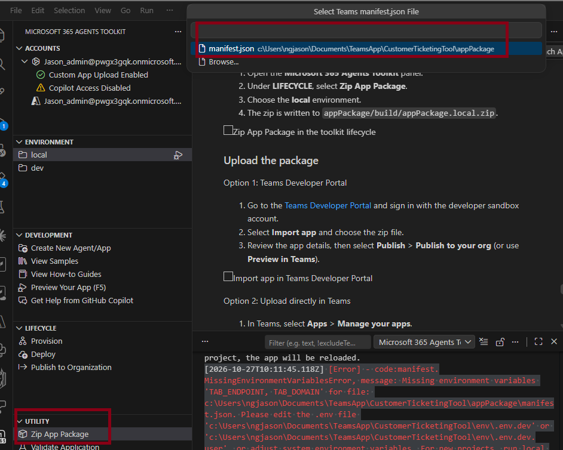

### Upload the package

Option 1: Teams Developer Portal

1. Go to the [Teams Developer Portal](https://dev.teams.microsoft.com/apps) and sign in with the developer sandbox account.
2. Select **Import app** and choose the zip file.
3. Review the app details, then select **Publish** > **Publish to your org** (or use **Preview in Teams**).

Option 2: Upload directly in Teams

1. In Teams, select **Apps** > **Manage your apps**.
2. Select **Upload an app** > **Upload a custom app** and choose the zip file.
3. Select **Add** to install it.

> Uploading a custom app requires custom app upload to be enabled for your account.

---

## 8. Troubleshooting

| Symptom | Cause / fix |
| --- | --- |
| `Invalid URL` in the server log | `.env` still has placeholders, or the process was started before `.env` was saved. Fix `.env` and restart the app |
| `Azure OpenAI error: 404 Resource not found` | Wrong endpoint, or `AZURE_OPENAI_DEPLOYMENT` is not the exact deployment name |
| `401` from Azure OpenAI | Wrong or expired API key |
| `Azure OpenAI is not configured on the server` | One of the three required variables is missing. Restart after editing `.env` |
| Port `3978`/`9239` already in use | Stop the previous **Start application** terminal and run again |
| Prerequisite check fails on the M365 account | Sign in again in the toolkit **ACCOUNTS** section, and confirm custom app upload is enabled |
| Changes to the UI are not visible | Wait for nodemon to finish rebuilding, then hard refresh (`Ctrl+F5`) the tab |
